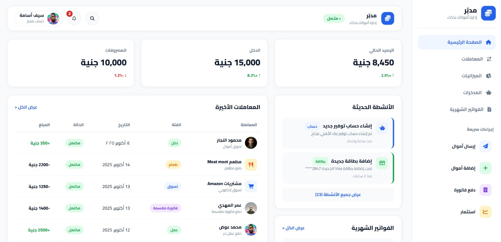
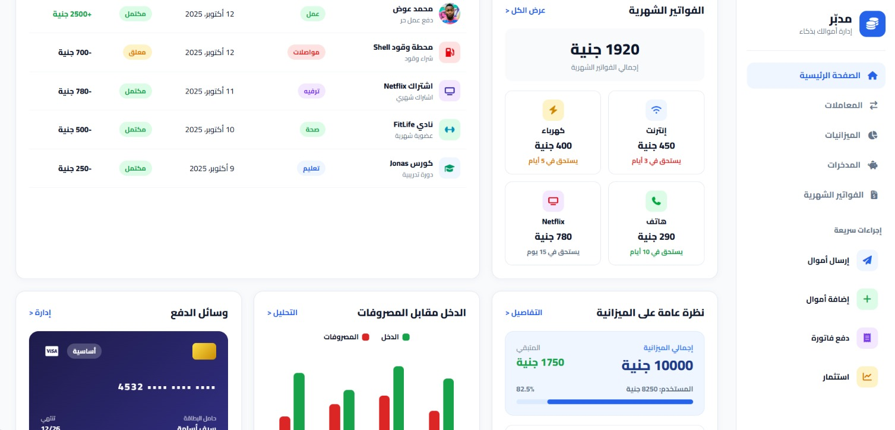
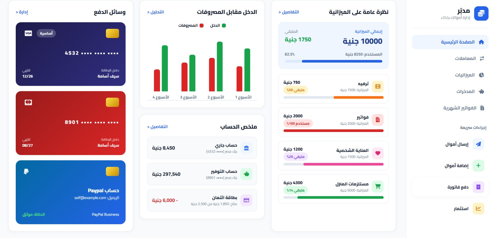

# 💰 Modabber | Personal Finance Dashboard

A modern, responsive Arabic personal finance dashboard UI built with HTML5 and CSS3.

Modabber (مدبّر) presents financial information through a clean, organized, and right-to-left interface.

## 🌐 Live Demo

[View Live Website](https://sandy-mohamed.github.io/Modabber-Finance-Dashboard/)

## 📸 Screenshots

### Dashboard Overview

### Bills and Budget

### Payment Methods and Accounts

## ✨ Features

- 📊 Financial overview dashboard
- 💳 Payment methods and account summary
- 💰 Income and expense visualization
- 📈 Budget overview
- 🧾 Monthly bills section
- 💸 Recent transactions
- 🔔 Recent activities and notifications
- 🏦 Savings and account navigation
- 📱 Responsive Arabic RTL design
- 🎨 Modern cards and visual indicators

## 🛠️ Technologies Used

- HTML5 — Page structure
- CSS3 — Styling and responsive layout
- Font Awesome — Icons
- Google Fonts — Cairo typography

## 📁 Project Structure

- `index.html` — Main dashboard interface
- `css/style.css` — Styling and responsive design
- `images/` — Icons and image assets

## 📌 Project Notes

Modabber is a front-end dashboard design demonstrating financial data presentation and responsive UI development.

The displayed financial information is sample content. The project does not include a backend or real banking integration.

## 🚀 Getting Started

1. Clone or download this repository.
2. Open the project folder.
3. Launch `index.html` in your browser.
4. Explore the dashboard layout.

## 👩‍💻 Developer

**Sandy Mohamed**

Front-End Developer

[GitHub Profile](https://github.com/sandy-mohamed)
